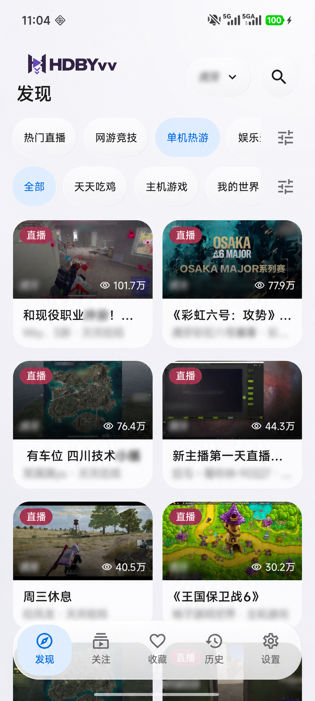
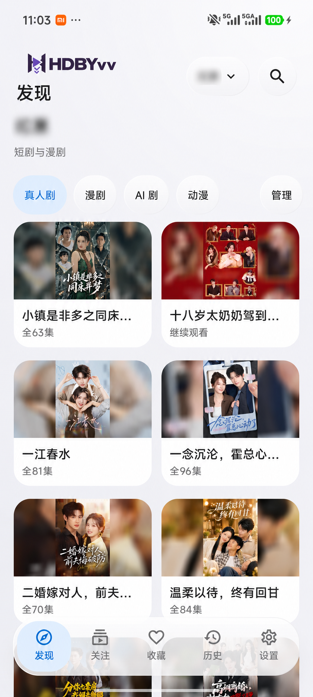
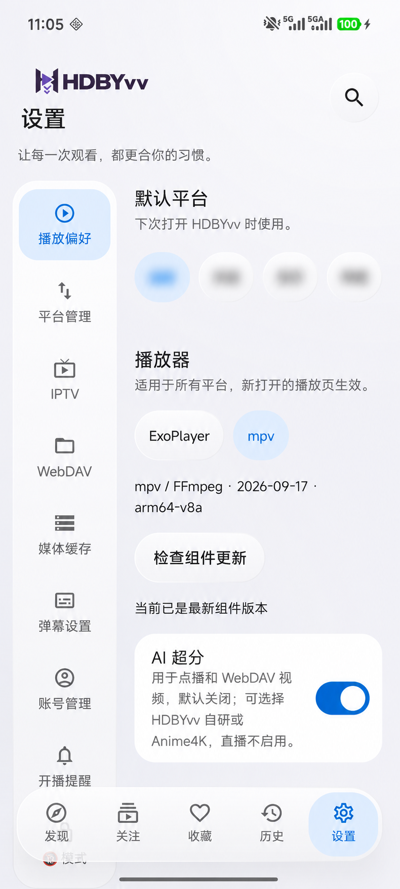
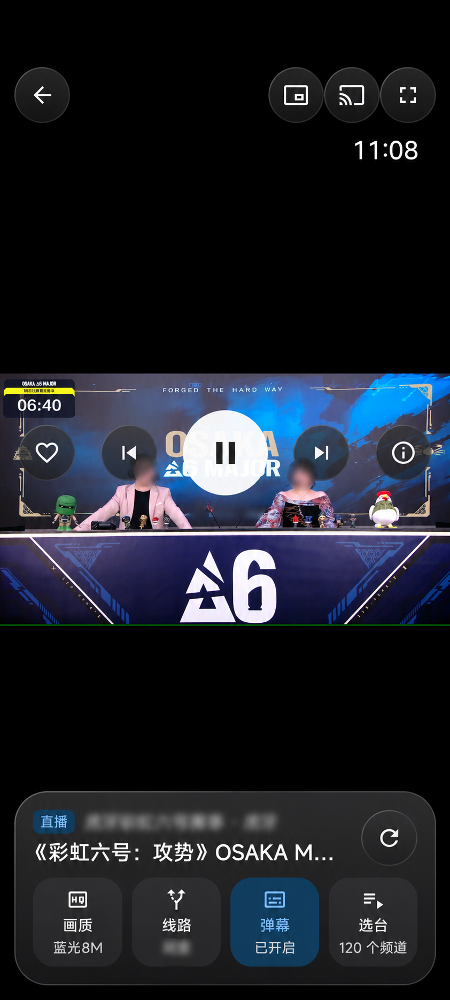
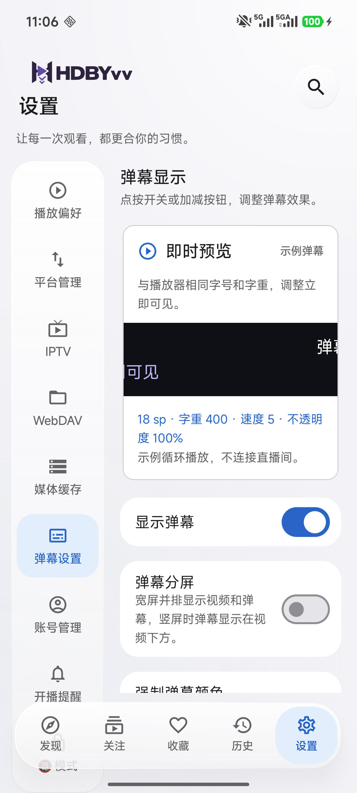
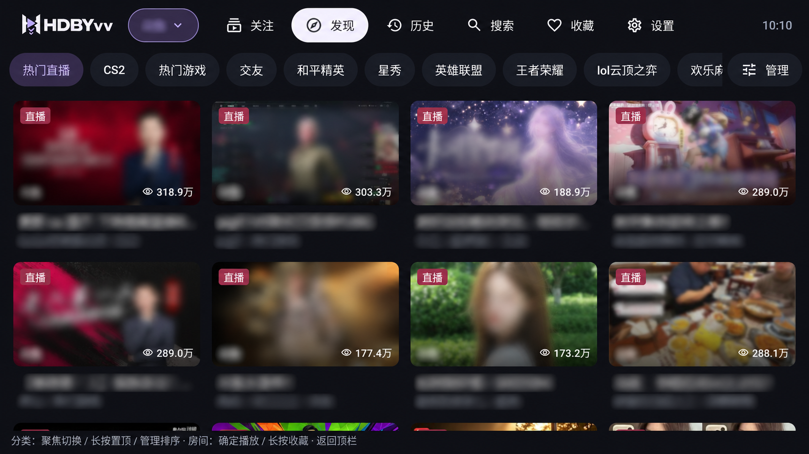
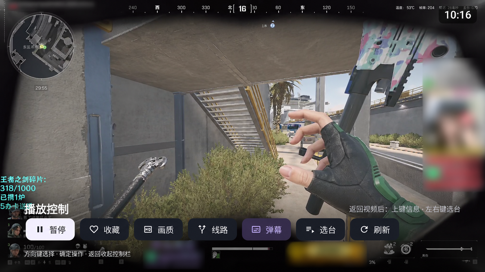
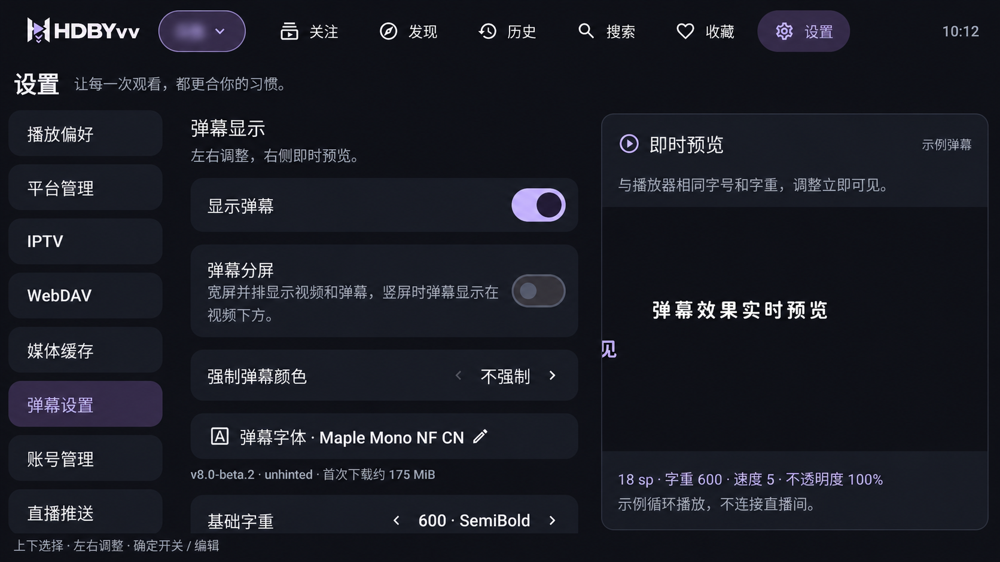

  
  
支持手机、平板、Android TV 与 Android 车机的直播聚合（虎牙、斗鱼、Bilibili、抖音、YY、快手、Twitch）、点播与 WebDAV 媒体客户端

HDBYvv 使用 Kotlin 与 Jetpack Compose 原生实现，支持触控、遥控器和不同窗口尺寸，将直播发现、点播、IPTV、WebDAV 文件、弹幕、关注、收藏与历史记录集中到一个应用中。

> 当前版本：`0.9.6` · 最低 Android 6.0（API 23）· 手机 / 平板 / Android TV / Android 车机 · 项目仅用于技术研究。
>
> 本项目基于既有客户端的协议与交互研究重新实现，仅用于技术研究。

## 功能

### 直播发现与平台管理

- 接入虎牙、斗鱼、哔哩哔哩、抖音、YY、快手、Twitch，支持平台切换、一级分类、细分分类与分页加载。
- 移动端支持下拉刷新；再次选择当前分类可刷新内容。刷新失败时保留已有列表并提示重试。
- 「设置 → 平台管理」可调整平台显示顺序和显隐，修改自动保存。移动端拖动排序，TV 使用遥控器上移 / 下移。
- IPTV 和 WebDAV 配置入口统一放在设置中；没有配置时，不出现在切换平台列表里。
- 自适应 16:9 直播卡片展示直播状态、标题、主播、分区与热度。电视保持四列，触控设备按窗口宽度与字体大小调整列数。
- 支持刷新关注、收藏和观看历史中的开播状态；请求失败时保留未知状态。

### 直播与点播播放器

- 「设置 → 播放偏好」可选择 Media3 / ExoPlayer 或 mpv，默认 ExoPlayer。首次使用 mpv 时按设备架构下载并验证组件；支持组件更新和回退，部分变更需重启应用后生效。
- 直播支持播放 / 暂停、刷新、收藏、画质与线路切换、播放列表选台。遥控器左右键可快速换台，线路故障时可尝试下一条可用线路；按直播间记忆清晰度。
- 点播支持 0.5×–3.0× 倍速、进度拖动、帧缩略图预览、快进快退、上下一集、自动连播及逐集续播。手机可切换竖向窗口与横向全屏，并保留播放进度和倍速。
- Android 11+ 可按片源帧率和倍速请求合适的显示刷新率，最终由系统决定。
- 手机和平板的直播、点播播放器支持画中画和 DLNA 投屏。Android 8.0+ 且支持系统画中画的设备可通过播放器按钮或播放时返回桌面进入小窗。
- DLNA 投屏需要手机与电视在同一局域网，手机转发当前视频；点播拖动进度和媒体格式兼容性取决于接收设备。
- 普通后台切换时暂停本地播放，返回后保留手动暂停状态；画中画保持小窗播放。播放遵循音频焦点，耳机断开时暂停。

### 短剧与点播

- 接入红果，支持真人剧、漫剧、AI 剧与动漫分类，以及按剧名搜索、收藏、观看历史、选集和断点续播；这些记录独立保存。
- 默认选择片源提供的最高兼容分辨率，也可手动切换清晰度；切换时保留进度和暂停状态，当前会话后续分集优先沿用所选档位。

### AI 超分与 HDR

- mpv 点播视频（含 WebDAV）支持 HDBYvv 自研 / Anime4K 超分和独立 SDR→HDR；直播、音频不启用增强。
- 超分默认关闭，算法默认 HDBYvv 自研；Anime4K 可选择 1080p、2K、4K 或自动目标。自动档位根据实际播放性能调整。
- 持续掉帧时会撤下超分、保留原画，设置偏好保持不变，可手动重新开启。视频信息中可查看源分辨率及实际超分输出。
- SDR→HDR 默认关闭，提供 500 / 750 / 1000 尼特档位，需要 Android 9+、支持 HDR10 / HDR10+ 的播放屏幕及兼容的 10 位输出能力。
- 原生 HDR 视频不重复增强，4K 及以上原片不启用超分；设备或片源不适用时保留原画播放。效果与性能取决于片源、屏幕和 GPU。

### 自定义 IPTV

- 在「设置 → 自定义 IPTV」添加、编辑、启用或移除多个平台，支持 HTTP / HTTPS M3U 频道列表，以及 hd.rip 兼容站点。
- 普通 IPTV 支持频道分组、搜索、自定义 User-Agent / Referer / Origin、本机播放并发限制、收藏和观看历史。
- 支持 M3U 自带 Logo、XMLTV 节目单及 gzip 压缩。播放器支持字幕轨道，TV 可查看节目单和换台提示。
- hd.rip 支持自动获取频道与节目单、平台字幕和可选 P2P 加速。P2P 默认开启，可在平台配置关闭；暂停、进入后台或退出播放后停止共享，P2P 不可用时使用 HTTP。
- TV 可在「手机扫码配置」中让同一局域网的手机新增或编辑平台、测试连接并保存到电视。二维码 10 分钟有效，关闭窗口或进入后台会结束当前配置连接。

### WebDAV 文件与媒体

- 在「设置 → WebDAV」管理多个服务器，支持 HTTP / HTTPS、匿名或 Basic 认证；配置后从切换平台进入文件浏览。TV 支持用同一局域网的手机扫码新增、编辑和测试连接。
- 顶部筛选按钮提供「视频 / 音频 / 图片 / 全部」，自动记住上次选择。
- 文件列表显示大小、修改日期和时间；筛选右侧的排序按钮支持按文件名、时间或大小升序 / 降序排列并保存偏好。连播和图片翻页遵循当前排序。
- 目录树默认隐藏，可在设置中开启。路径栏可返回上级目录。TV 按菜单键可将焦点移到筛选按钮。
- 长文件名在手机端横向滚动显示。
- 支持 MP4、MKV、WebM、FLV、AVI、TS、MOV、RMVB 等视频，以及 MP3、FLAC、AAC 等音频。已安装 mpv 时优先使用 mpv / FFmpeg；部分格式需要下载组件，实际可播编码仍取决于解码能力。
- 列表显示已知时长、上次播放位置或「已播完」；「探测视频时长」默认关闭，开启后按需探测，关闭后仍保留已知时长。
- 「视频从上次位置续播」默认开启，手动播放和自动连播均续播未完成的视频。音频使用独立播放页面，每次从头播放。
- 视频和音频可开启当前文件夹连播。
- 图片全屏等比预览，手机额外提供返回按钮。手机支持左右滑动；TV 使用遥控器左右键翻页。
- 「设置 → 媒体缓存」和 WebDAV 设置可分别清理图片与音视频缓存。清理不会删除服务器文件、主动下载的本地文件或视频进度。

### 实时弹幕

- 已接入虎牙、斗鱼、哔哩哔哩、抖音、快手、Twitch 共 6 个平台的实时弹幕；YY、IPTV 和点播内容不提供实时弹幕。
- 支持叠加弹幕和弹幕分屏。电视右侧使用 `1/7` 区域，触控宽屏保留可读宽度，竖屏采用视频在上、弹幕在下；分屏消息自动跟随更新。
- 可调整颜色、字体 / CSS URL、字重、字号、行数、速度、不透明度和重复过滤；手机和平板分别保存横屏、竖屏的滚动弹幕行数，最大行数随可用高度与字体动态计算，设置页提供即时预览。
- 支持虎牙、抖音、哔哩哔哩、斗鱼和快手的最低用户等级过滤；等级未知的消息保留。哔哩哔哩、斗鱼、虎牙、抖音和 Twitch 支持平台图片表情。
- 界面与弹幕提供霞鹜文楷、MiSans、Maple Mono NF CN 字体预设，选择后下载并缓存；可按字体资源选择字重。

### 搜索、登录与个人内容

- 支持具备搜索能力的平台按主播名 / 房间号查找，粘贴支持的直播间链接可识别并播放。抖音关键词搜索需要登录；哔哩哔哩遇到搜索验证时可扫码完成后重试。
- 虎牙、斗鱼、抖音、哔哩哔哩、快手支持扫码登录，提供二维码刷新、过期提示和退出登录；保留默认隐藏的 Cookie 导入入口。登录能力与关注同步能力分别以平台能力表为准。
- 收藏与历史支持长按单条删除、管理模式多选、全选和删除确认；历史支持继续播放，删除历史与删除收藏互不影响。
- 收藏支持开播提醒：应用在前台时每 10 分钟检测一次，可按单个直播间或批量设置；多个开播提醒可选择观看，播放器中的提醒显示在右下角。
- 收藏与历史各自提供「隐藏 IPTV」选项，独立保存偏好，仅影响展示，不删除已有记录。

### 手机推送直播

- 打开电视端「设置 → 直播推送」，用同一网络的手机扫码或访问电视显示的地址，粘贴支持平台的直播间链接或完整分享文案；斗鱼还支持纯数字房间号。
- 再次推送会切换当前直播间。保持应用在电视前台即可接收，退到后台自动停止接收，也可手动关闭。
- 推送页面内置于应用，适配手机和电脑。默认端口 `8383`，端口占用时以界面地址为准；Android 17 及以上首次使用需允许局域网访问。

### 应用更新

- 启动应用或从后台返回时异步检查版本，也可在「设置 → 关于 → 应用更新」手动检查并查看更新日志。
- 应用更新与 mpv 组件更新独立。
- 下载支持进度、暂停与续传。安装前校验更新清单签名、文件大小、SHA-256、包名、版本和 APK 签名，再由用户确认系统安装。

### 界面与设备适配

- 同一个 APK 支持手机、平板、Android TV 和可安装 Android APK 的车机。触控端采用圆角浮动导航与半透明界面；TV 保留适合遥控器的布局和焦点反馈。
- 「设置 → 外观」支持跟随系统、浅色、深色；移动端默认跟随系统，TV 默认深色，选择自动保存。
- 手机使用发现 / 关注 / 收藏 / 历史 / 设置五项导航，支持顶部搜索、长按操作、横竖屏播放；平板和宽屏窗口使用侧边导航，支持旋转与分屏。
- 设置页采用左侧分类、右侧内容，两侧独立滚动；宽屏弹幕设置提供双栏预览。普通触控目标至少 48dp，车机主要操作目标至少 64dp。
- Android TV 支持 Leanback 入口，触屏非必需，保持横屏；提供 D-pad 焦点、描边 / 放大反馈、长列表焦点恢复，以及菜单键、媒体键和频道切换键。
- 车机系统遮挡界面或应用离开前台时暂停音视频；行驶限制由系统提供，实际表现仍需对应车机验证。不包含 iOS、CarPlay 或 Android Auto 投射端。

## 平台能力

| 平台 | 内容浏览 / 播放 | 实时弹幕 | 站内搜索 | 扫码登录 | 关注同步 |
|---|:---:|:---:|:---:|:---:|:---:|
| 虎牙 | ✅ | ✅ | ✅ | ✅ | ✅ |
| 抖音 | ✅ | ✅ | 登录后可用 | ✅ | — |
| 哔哩哔哩 | ✅ | ✅ | ✅ | ✅ | ✅ |
| 斗鱼 | ✅ | ✅ | ✅ | ✅ | — |
| YY | ✅ | — | — | — | — |
| 快手 | ✅ | ✅ | ✅ | ✅ | — |
| Twitch | ✅ | ✅ | ✅ | — | — |
| IPTV / hd.rip | ✅ | — | 频道搜索 | — | — |
| 红果短剧 | ✅ | — | 剧名搜索 | — | — |
| 🔞 | ✅ | — | ✅ | — | — |
| WebDAV | 目录浏览 / 媒体播放 | — | — | — | — |

扫码登录指通过对应平台的登录流程授权。部分平台内容与关注列表需要有效登录状态，接口可用性以运行时结果为准。

## 隐私与安全

- 平台登录 Cookie 保存在应用本地，界面默认隐藏；WebDAV 密码使用 Android Keystore 加密保存。应用关闭 Android 备份。
- 手机推送与扫码配置由设备提供局域网页面。IPTV 和 WebDAV 的配置二维码使用临时随机地址，关闭配置窗口、过期或进入后台后失效；直播推送在应用进入后台后停止接收。请仅在可信网络中使用。
- 图片、音视频缓存保存在应用私有目录，可分别清理。WebDAV 缓存按连接、账号与文件版本隔离，跳转到其他域名的媒体链接不携带 WebDAV 认证。
- 应用会上报崩溃、ANR、基础生命周期诊断、API 异常。
- 默认不启用性能采样、录屏、截图、视图层级或自动日志上传；关闭 SDK 自动采集 Cookie、HTTP 请求 / 响应头和正文、URL 查询参数等内容。mpv 组件来自官方发布源。
- hd.rip 开启 P2P 时会与同频道节点交换媒体分片，可在平台设置关闭。分享问题日志或截图前，请自行移除账号、Cookie、订阅链接和局域网配置二维码等敏感信息。

## 已知限制

- 暂不包含 TVBOX 和 X5 网页直播。DLNA 投屏需要兼容的接收设备，不能保证所有电视均支持全部片源格式与进度控制。
- 平台可能调整接口、签名或风控策略，导致分类、取流、弹幕、登录或关注同步临时不可用；扫码登录不代表该平台支持全部能力。
- Twitch 当前主要支持匿名公共直播，网络需能访问相关服务；订阅专享或地区受限内容可能无法播放。快手短分享链接暂不支持，可使用完整直播间链接。
- 普通 IPTV 仅支持 HTTP / HTTPS 频道，不支持 RTSP / UDP、XMLTV 回看或节目预约；EPG 和 Logo 的完整性取决于配置的数据源。
- WebDAV 时长探测、拖动和媒体兼容性取决于服务端 Range 支持、网络与解码器。AList 之外的服务使用标准 WebDAV 加载，尚未对接 CloudDrive2 专有缩略图接口。
- 超分和 SDR→HDR 无法恢复原片缺失的真实细节；是否可用及实际效果取决于设备能力。Android Automotive 的行驶限制和厂商特殊屏幕仍需目标车机实测。

## 应用截图

平台名称、主播名称及相关水印使用局部模糊处理。

### 手机端

竖屏浏览、短剧分类与播放偏好。点击图片可查看大图。

<table>
  <tr>
    <th>直播发现与分类</th>
    <th>短剧与选集入口</th>
    <th>播放内核与画质增强</th>
  </tr>
  <tr>
    <td></td>
    <td></td>
    <td></td>
  </tr>
</table>

播放器顶部提供画中画、DLNA 投屏与全屏入口；弹幕设置可即时预览显示效果。

<table>
  <tr>
    <th>竖屏播放器与投屏入口</th>
    <th>弹幕设置与即时预览</th>
  </tr>
  <tr>
    <td></td>
    <td></td>
  </tr>
</table>

### 电视端

四列直播网格、遥控器播放控制与弹幕预览，保留大屏导航和焦点反馈。

**发现与分类浏览**

**播放控制**

**弹幕设置与即时预览**

全部新图保存在 [`features`](features/) 目录，旧版截图保留。

## 声明

本工程只根据协议与交互研究结果重新实现。项目仅供技术研究，请勿用于商业用途，也请遵守所在地区法律法规及各平台服务条款。
